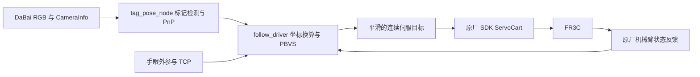

# FR3C 目标持续跟踪重新设计方案

日期：2026-10-08。目标已经确认：机械臂末端跟随目标移动、保持固定距离，先跟位置，再跟姿态。

实施更新：用户选定已有 30 mm 方块，顶面标签实测边长 20 mm；实时画面识别为 AprilTag 36h11 / ID 1。前四步已完成：视觉位姿、只读反馈和基坐标预览、原厂执行端，以及 XYZ 位置跟随。第四步实机效果已由用户确认可用，首轮默认 100 mm 软件范围停止也有日志诊断；第五步新增 `start_demo.sh` 统一运行入口，沿用当前执行端配置，不要求额外一分钟演示。姿态暂不用于控制。具体资源、启动方法和实测结果见 `docs/目标持续跟踪开发记录-20261008.md`。

建议采用 **AprilTag 标记 + 基坐标系 PBVS + 原厂 SDK 连续伺服**。新建独立模块，不从原有视觉伺服控制器、状态机或调参方案继续修改。现有相机驱动、硬件接口、标定文件和机器人模型作为基础资源使用。

这份文档是资源核查后的开发设计。前四步已完成，用户确认第四步真实测试效果可用。第五步沿用现有位置跟随链路，新增统一启动、操作和关闭入口，见 [Demo 使用说明](./目标跟踪Demo使用说明-20261008.md)。按用户本次要求，不增加额外的一分钟理论测试；下文的控制频率、速度和跟踪误差只作为开发起点或后续优化参考。

## 1. 当前可以使用的资源

| 资源 | 核查结果 | 新方案中的用途 |
| --- | --- | --- |
| 主机 | RK3588 / AArch64，ROS 2 Humble | 运行轻量标记检测和控制节点 |
| 机械臂 | FR3C，项目固定的控制器版本 V3.9.2、C++ SDK 2.3.2 | 使用原厂连续伺服和实时状态反馈 |
| 相机 | DaBai DCW2，项目配置为末端安装 | 保留 eye-in-hand 安装方式 |
| 相机数据 | 640×480 RGB、彩色内参、硬件对齐深度 | RGB 测位姿，深度可选校验 |
| 帧率 | 2026-09-22 历史生产复测：彩色 13.79 FPS、深度 12.53 FPS | 第一版按低速目标设计，重新实测端到端延迟 |
| 手眼标定 | `flange_link → camera_link` 已标记 accepted，保存的验证平移 P95 约 2.73 mm | 安装未变时快速复核后复用 |
| 夹爪 TCP | 已有 `flange_link → grasp_frame` 标定，Z 约 184.6 mm | 将夹爪跟随目标转换为正确的控制点目标 |
| OpenCV | 本机 Python 环境实际为 4.10.0，具备 `aruco`、`DICT_APRILTAG_36h11`、`ArucoDetector` 和 `SOLVEPNP_IPPE_SQUARE` | 首版直接使用现有库 |
| 原厂接口 | 本地头文件具备 `ServoCart`、`ServoJ`、`ServoMoveStart/End`、状态反馈和停止接口 | 独立 C++ 执行驱动 |

相机和标定证据属于历史记录，不能视为当前硬件状态已通过复测，也不能把手眼验证误差当作动态跟踪精度。

主要资源位置：

- 相机配置：`src/fr3c_camera/config/dabai_dcw2_15fps.yaml`。
- 相机实测：`evidence/optimization/20260922_camera_fps/README.md`。
- 手眼外参：`src/fairino3mt_v6_moveit2_config/config/dabai_dcw2_handeye.yaml`。
- TCP：`src/fairino3mt_v6_moveit2_config/config/ydi_j22_tcp.yaml`。
- SDK：`src/fairino_hardware/libfairino/include/robot.h` 和同包的 ARM64 动态库。
- 机器人模型：`src/fairino3mt_v6_moveit2_config/config/fairino3mt_v6_robot.urdf.xacro`。虽然包名含 `3mt`，当前实际引用的是与 FR3C 控制器匹配的 `fairino3c_v6.urdf`。

## 2. 目标使用 AprilTag

“像马赛克一样”的黑白方块通常是 AprilTag 或 ArUco。第一版选择单个 **AprilTag 36h11**，通过现有 OpenCV 的字典检测它，再用 PnP 求解位姿。这里使用的是 OpenCV 检测实现，不等同于已经安装了原生 AprilTag 3 检测器。

当前使用用户选定的 20 mm 标签，贴在已有 30 mm 方块顶面，不更换目标。在目前 640×480 图像下，标签约占 27–30 px，使用实机对比选定的小标签检测参数。标签尺寸按检测角点之间的实际边长计算，外侧白边不计入；观察位置需要保证标签完整、末端不遮挡标签。

相机内参、畸变、标记尺寸和四个角点共同给出目标相对相机的三维位置与旋转。因此，**第一版可以只用 RGB 得到有尺度的位姿，不需要逐帧依赖深度图**。估计姿态有噪声，平面标记也可能产生候选解歧义；通过重投影误差、正深度和时间连续性选择位姿，首版控制只使用其中的平移。

深度图可以检查 PnP 距离是否明显异常。加入时要按时间戳配对，并使用已有的彩色畸变到 D2C 网格映射，不能直接把彩色中心像素当作对齐深度的采样点。首版先保留现有相机配置；如果深度聚合拖慢 RGB，再单独验证仅开彩色的配置。感知节点不等待深度，不代表当前 `full_frame` 相机驱动已经解除了彩深发布耦合。

目标大幅转动后仍需可见时，再考虑刚性多标记板或多面标记，单标记足够用于首版验证。

## 3. 两个节点完成闭环

新包建议命名为 `fr3c_target_follow`，先实现两个节点：



- `tag_pose_node`：Python + 现有 OpenCV。订阅 RGB 和内参，输出携带原图时间戳的 `PoseStamped` 及检测质量，图像队列只保留最新帧。
- `follow_driver`：C++。拥有唯一的运动 SDK 连接，缓存机械臂反馈，完成坐标变换、轻量滤波、跟随控制、伺服发送和停止处理。视觉处理与发送线程分离。

第四步实施时沿用第二步已验证的 Python 图像时刻坐标换算，作为无运动的 `transform_only` 节点；新增 C++ `position_follow` 独占 SDK，提供反馈、记录偏移并处理滤波、控制和发送。这样保留现有手眼、光学坐标和反馈插值实现，控制仍按执行端实际节拍推进。第二步的 50 Hz 一步预览不会成为伺服指令。

提供开始、停止、记录偏移三个操作即可。RViz 显示标记坐标轴、目标位置、实际 TCP 和误差；调试记录视觉数据年龄、目标位置、实际 TCP、发送周期和 SDK 返回码。

首版不需要训练识别模型。MoveIt 可用于观察模型或将机器人移动到起始位置；跟踪启动时由新的 SDK 驱动独占运动，跟踪过程中不反复规划抓取轨迹。第四步追加轻量防碰撞：复用抓取/分类的机器人、夹爪和相机碰撞模型，加入固定 XY 工作台，在独立线程检查实测状态和短距离运动预测，由 SDK 执行端应用减速与暂停。暂不加入点云/深度场景；工作范围、速度和停止处理继续保留。实现与验证见《目标跟踪轻量防碰撞使用说明-20261008.md》。

## 4. PBVS 如何保持距离

### 先把目标换算到机器人基坐标系

相机在末端上，会随着机械臂移动。因此用拍摄时刻的法兰位姿，将观测变换到基坐标系：

```text
T_base_tag(t_image) = T_base_flange(t_image)
                    × T_flange_camera_link
                    × T_camera_link_color_optical
                    × T_color_optical_tag(t_image)
```

标定文件的子坐标系是 `camera_link`，检测输出属于 `camera_color_optical_frame`，中间的驱动光学坐标变换必须保留。缓存带时间戳的机械臂位姿并在图像时间上插值；同时核对相机与反馈的时钟关系和数据年龄，不能将旧图像配上任意最新机器人位姿。

快速验证方法是把标记固定，让机械臂缓慢移动：换算后的标记基坐标应基本不变。这同时检查变换方向、单位、时序和相机安装是否变化。

### 第一版保持平移偏移和末端姿态

先把末端放在合适的跟随位置，记录一次：

```text
d0 = p_tcp_initial - p_tag_initial
p_tcp_desired = p_tag_filtered + d0
R_tcp_desired = R_tcp_initial
```

这里的 `d0` 是基坐标系中的固定向量，所以末端与标记中心保持固定偏移，也保持固定距离。标记转动不会让机械臂立即跟着转。这个“记录一次偏移”的方式比反复手填三个方向的距离更直观。

控制从简单的位置比例反馈开始：

```text
v_tcp = Kp × (p_tcp_desired - p_tcp_actual)
```

对速度和加速度限幅，生成平滑的短步伺服参考，使用实际 TCP 反馈持续修正。视觉帧更新目标，发送循环在帧间连续推进参考；不让一帧图像直接触发一次大步位置跳变。

先使用按实际采样间隔计算的轻量低通滤波。后续若匀速移动存在明显滞后，再加目标速度前馈和很短的延迟补偿；预测只覆盖新鲜数据的短时间窗，丢失目标后不能持续外推。

### 第二版扩展为完整相对位姿

记录目标到 TCP 的相对变换：

```text
T_tag_tcp_offset = inverse(T_base_tag_initial) × T_base_tcp_initial
T_base_tcp_desired = T_base_tag_current × T_tag_tcp_offset
```

这样目标旋转时，末端的位置和姿态会一起跟随。旋转误差用旋转矩阵或四元数处理，避免直接相减或插值欧拉角。标记姿态稳定性不足时，可升级刚性多标记板。

## 5. 执行接口与开发起点

优先测试原厂 `ServoCart`，先使用基坐标系的绝对目标形式，由应用控制目标更新速度。它直接接收笛卡尔参考，可让首版位置跟随保持简洁。[原厂运动接口文档](https://fairino-doc-en.readthedocs.io/latest/SDKManual/CPPRobotMovement.html)可用于查阅概念，调用签名以本项目 SDK 2.3.2 的头文件为准；最新文档中的扩展轴和 UDP 参数与本地版本不同。

项目现有 `ServoJ` 配置为 8 ms / 125 Hz。**这不是 `ServoCart` 已经在本机稳定达到 125 Hz 的证据。** 开发第一步应单独测量原厂伺服调用耗时、实际发送间隔、反馈响应和停止行为，再确定周期。若 `ServoCart` 在当前固件上不合适，保持上层 PBVS 不变，将执行端替换为连续逆运动学 + `ServoJ`，并验证求解耗时与关节解连续性。

新驱动直接调用类型明确的 C++ SDK，不通过 ROS 字符串命令服务高速发送。在现有 `command_server.cpp` 中，`ServoJ` 的 `deltaT` 被存入 `int`，小数周期会被截断，这是需要避开的接口事实；本方案不修改已有服务。

TCP 文件中 `controller_tool_id` 仍为空，不能据此假定控制器工具表已经与项目标定一致。执行前核对当前工具和工件坐标；可将匹配的 TCP 作为控制点，或用工具 0 控制法兰、在软件中换算 TCP 目标。内部使用米、弧度和明确的坐标系，SDK 边界统一转换为毫米、角度。

建议初始设置：

| 项目 | 开发起点 |
| --- | --- |
| 目标移动速度 | 约 10 mm/s，之后提高到 20 mm/s |
| TCP 速度上限 | 约 20–30 mm/s，平滑限制加速度 |
| 位置增益 | `Kp` 约 1–2 /s，依据振荡和滞后调整 |
| 视觉更新 | 使用当前实际 RGB 帧率，队列不积压 |
| 伺服周期 | 独立实测后确定，8 ms 仅作为候选 |
| 新鲜观测超时 | 约 250 ms 起测，依据实际数据年龄核验 |

目标丢失或观测过期后停止追踪并减速保持，不无限重复最后的非零速度。SDK 报错、反馈过期或越出跟随工作范围时走明确停止路径。恢复时连续看到有效标记后平滑接续，不能跳向积压的旧目标。正常停止和故障停止的实际效果要在独立伺服验证中测清。

## 6. 按四步开发和验证

1. **先验证执行端。** 固定小步目标，检查三个平移方向的实际响应、发送节拍、工具坐标和停止操作。这一步直接回答底层能否连续执行。
2. **验证目标位姿。** 识别标记，显示坐标轴；固定标记、缓慢移动机械臂，检查基坐标位置稳定；确认标记尺寸、畸变和手眼变换正确。
3. **完成 XYZ 跟随。** 记录偏移，锁定末端姿态，让目标分别沿三个方向低速移动，然后做组合运动、暂停、遮挡和恢复。
4. **加入姿态与性能优化。** 完整相对位姿跟随，再依据记录的误差和延迟添加速度前馈、多标记或更高帧率配置。

第一版的验证目标可以定为：目标约 10 mm/s 移动时，连续跟随两分钟，位置偏移误差 P95 争取控制在 20 mm 内；目标停止后误差收敛，无明显持续振荡；遮挡后触发停止，重新出现时平滑恢复。它们是初始目标，尚未实测通过。同步记录视觉估计误差，并用尺量、固定位置检查或独立录像辅助核验，避免只凭闭环内部计算宣称真实精度。

位置跟随通过后，再提高速度和缩小误差。当前十几帧/秒的视觉更新适合先验证低速闭环；更快目标的性能应由总延迟和实测跟踪误差决定。

## 7. 参考依据

- [AprilRobotics AprilTag](https://github.com/AprilRobotics/apriltag)：标记位姿估计、相机参数、尺寸定义和坐标约定。
- [OpenCV ArUco 文档](https://docs.opencv.org/4.x/d5/dae/tutorial_aruco_detection.html)：四角点标记检测和位姿估计。当前网页 API 应与本机 OpenCV 4.10 的接口核对。
- [FAIRINO C++ 运动接口](https://fairino-doc-en.readthedocs.io/latest/SDKManual/CPPRobotMovement.html)：连续伺服接口概念，本地 SDK 头文件决定实际可用签名。
