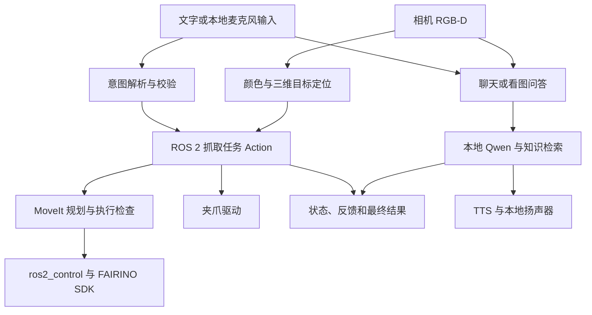

# RK3588 端侧智能体软件交付验证与前端交接指南

> 更新日期：2026-10-08（北京时间）
>
> 工作区：`/home/industio/fairino_ws`
>
> 规划依据：[端侧智能体实验箱设备.docx](初始规划文档/端侧智能体实验箱设备.docx)，含正文、实验箱示意图和五层软件架构图。
>
> 实现依据：当前源码与配置，Git 基线 `3167238`（2026-09-24），以及已有开发报告和验收记录。
>
> 本次工作为文档整理与代码核对，没有启动设备、发送运动命令或重新进行现场验收。

## 1. 本次软件交付要达到什么效果

按本次确认的范围，**算力平台以当前 RK3588 为准，机器人、相机、夹爪和音频设备以现有配置为准，只交接软件和功能展示**。不把箱体尺寸、折叠收纳、昇腾兼容、OpenHarmony、双系统或更换硬件列为本次交付任务。

规划书的核心展示可以归纳为一句话：

**在不依赖云端的条件下，用户能打字或说话，系统能看见目标、理解任务、调用机械臂执行，并把真实过程和结果展示出来；同时支持普通问答、看图问答和本地知识库。**

本文件围绕这条主线，回答五个问题：

1. 规划书的软件展示，在当前项目里分别对应什么？
2. 接手者怎样启动、复现并演示？
3. 演示怎样判定通过，证据存在哪里？
4. 前端应该接哪些接口、显示哪些数据？
5. 还有哪些软件事项需要补测或补齐？

“已有代码”“历史验证通过”“本次交付演示通过”分开记录。不能因为几次历史抓取成功，就声称当前版本的全部展示已经验收。

## 2. 规划书软件要求与当前实现对应表

规划书使用 Llama.cpp、Ollama、ChromaDB、LangChain 等作为技术路线或示例。本轮以当前 RK3588 的实际实现复现功能效果：RKNN/RKLLM、Qwen3-VL-2B、Sherpa、ROS 2/MoveIt 和本地检索。工具名称替换、功能覆盖和仍缺少的实验内容在下表说明。

| 编号 | 规划书的软件内容 | 当前对应实现 | 交付展示方式 | 当前边界 |
|---|---|---|---|---|
| S01 | 实验1：端侧视觉感知、物体分类、颜色识别 | HSV + RGB-D 顶面几何；另有 RKNN YOLO 模式 | 放红黄蓝绿方块，展示识别画面、颜色、位置和尺寸；YOLO 按既有类别另演示 | 方块主线不是通用物体检测；当前 YOLO 是旧项目16类垃圾模型。未找到已交付的人脸追踪实现，不能演示为已完成 |
| S02 | 实验2：离线 ASR 与 TTS | RKNN Zipformer ASR，Matcha + Vocos TTS；按钮/唤醒输入 | 真人说话→显示定稿→模型回答→本地扬声器播报 | 半双工，真人噪声和整机长循环仍需验证；唤醒是增强项 |
| S03 | 实验3：端侧推理环境和量化模型 | Qwen3-VL-2B，RKNN 视觉 + RKLLM 语言，W8A8 配置，单 Worker | 展示模型配置、本地服务健康和断网问答 | 当前不是 Llama.cpp/Ollama 部署；没有把 INT4/INT8 性能对比作为已完成实验 |
| S04 | 实验4：Prompt 与本地 RAG | 严格意图 Prompt；BGE + SQLite/NumPy 只读检索 | 展示命令解析、资料型问题回答和出处 | 当前检索索引复用旧项目；不等于已经导入学校/实验室规章制度，也不是在线建库工具 |
| S05 | 实验5：机械臂正逆运动学、指定 XYZ | 控制器一致的 URDF、MoveIt FK/IK、规划；`MoveToPose` Action | RViz 展示目标与完整路径；已确认坐标的受控执行 | 坐标来自基座坐标系，单位米；不让模型自由生成关节指令 |
| S06 | 实验6：底层通信、角度/速度控制 | FAIRINO SDK + ros2_control 网络控制；FT232H 夹爪驱动 | 展示控制器/关节状态、规划参数和夹爪开闭接口 | 按现有设备展示驱动链。串口总线舵机协议实验没有在该工程实现，不标为“串口实验已完成” |
| S07 | 实验7：Agent 理解请求、调用视觉/机械工具、展示观察结果 | 受限意图路由 + 目标快照 + 抓取 Action + Feedback/Result | “把红色方块放到A区域”→找红块→规划→抓放→返航→显示结果 | 支持指定任务闭环；不是模型自主生成任意工具序列的通用 ReAct。前端可展示实际任务摘要和工具过程 |
| S08 | 实验8：VLM 输入摄像头图像，输出动作或空间描述 | 当前 RGB 帧截图 + Qwen3-VL 问答 | “你看到了什么”→显示本轮截图→输出画面描述 | 已有静态实拍图推理记录，实时相机与播报需在线复核；当前满足“描述”路线，抓取几何来自 RGB-D |
| S09 | 显示系统状态和 Thought/Action/Observation 日志 | Tk 对话页、ROS 状态、统一 trace | 展示输入、任务理解摘要、工具调用、阶段和最终结果 | 日志已有；新的网页工具过程面板及 HTTP API 尚未实现 |
| S10 | 全部端侧运行、软硬解耦 | 本地进程、ROS 消息和 Unix socket | 断互联网后冷启动；前端只提交业务任务 | 模型和部分 Python 环境引用外部本地目录，交接必须包含这些资产 |

**本轮展示重点：S01～S05、S07～S10 的基本功能，以及 S06 在现有设备上的驱动控制效果。** 人脸追踪、串口舵机实验、量化对比、通用多步 ReAct 和新网页属于未覆盖的软件内容；如果要求逐字覆盖规划书的全部教学实验，这些仍需另行补齐，不能以技术替代自动判为完成。

不把规划书的“32 学时课程”当作当前已交付教材。本文件提供软件展示与复现入口，不声称已有完整课件、学生实验手册和教学考核体系。

### 2.1 当前项目可以展示的任务

| 用户需求 | 对应能力 | 关键行为 |
|---|---|---|
| 抓起红色方块 | `pick_hold` | 抬升后保持夹持，不自动放下 |
| 把蓝色方块分类 | `pick_sort` | 放到既有颜色区域并返航 |
| 把黄色方块放到D区域 | `pick_place` | 颜色与目的区域解耦，可指定槽位 |
| 把红色方块放到蓝色方块上面 | `pick_stack` | 一次移动一个方块，红在上、蓝在下 |
| 自动码垛 | `pick_stack_auto` | 按固定顺序码整座塔，默认最多四层 |
| 你看到了什么 | 当前相机截图问答 | 只描述，不下发机械任务 |
| 你好 / 解释一个普通概念 | 普通聊天 | 本地模型流式回答 |
| 一条当前知识库包含的资料问题 | 本地知识检索问答 | 展示出处和知识版本 |
| 停止抓取 / 停止播报 | 独立停止入口 | 机械任务和音频分别停止 |

默认颜色映射：蓝→A、黄→B、红→C、绿→D；区域来自实际 A4 标定。规划书示例“左边的盒子”可先展示为明确命名的“A区域”。当前未定义“左边盒子”到某区域的稳定别名映射，不能假定 A 就是左边；如果要保留原话，需由前端/业务层增加经现场确认的目标别名。

## 3. 软件系统、文件和运行资产

### 3.1 软件链路



当前采用眼在手上的相机标定。检测位置、尺寸、任务坐标和轨迹都由确定性的机器人程序处理；大模型主要负责理解用户表达和生成回答。当前配置 `tools_enabled=false`，业务工具调用由 Python/ROS 层组织，不是 Worker 直接执行工具。

### 3.2 接手优先看的代码

以下路径相对工作区 `/home/industio/fairino_ws`。

| 文件/目录 | 接手用途 |
|---|---|
| `scripts/run_moveit_camera_rviz.sh` | 机器人、MoveIt、相机、夹爪、感知、任务与门禁统一启动 |
| `scripts/voice/start_dialogue_full.sh` | Qwen、TTS 和 GUI 完整启动及退出清理 |
| `src/fairino_msgs/action/PickColor.action`、`MoveToPose.action` | 当前业务接口原始定义 |
| `src/fairino_mtc_demo/src/first_grasp_node.cpp` | 抓取、分区、码垛、状态及失败处理主实现 |
| `src/fr3c_camera/fr3c_camera/blue_cube_localizer.py` | 颜色、深度、顶面位置和稳定快照 |
| `src/fr3c_voice/fr3c_voice/intent.py` | Prompt、结构化意图、否定/咨询等校验 |
| `src/fr3c_voice/fr3c_voice/action_bridge.py`、`task_guard.py` | Action 客户端、任务互斥、状态、图像与直接停止 |
| `src/fr3c_voice/fr3c_voice/dialogue_gui.py` | 现有 Tk 页面与完整交互流程 |
| `src/fr3c_voice/fr3c_voice/service.py`、`model_client.py` | 模型 Unix socket 服务和流式客户端 |
| `src/fr3c_voice/fr3c_voice/knowledge.py` | 本地检索、知识来源和降级 |
| `src/fr3c_voice/fr3c_voice/voice_input.py`、`wake_input.py`、`tts_service.py` | 按钮输入、唤醒、播报生命周期 |
| `src/fairino3mt_v6_moveit2_config`、`src/fairino_hardware` | 模型、规划配置、控制桥和 SDK |
| `src/fr3c_gripper_driver` | 两状态开环夹爪与诊断 |

### 3.3 环境和配置交付清单

| 项目 | 当前基线/位置 | 交接注意事项 |
|---|---|---|
| 软件平台 | RK3588 / ARM64 / Ubuntu 22.04 / ROS 2 Humble | 不混入其他工作区的 overlay，不顺手升级依赖 |
| 工作区/机器人 | `/home/industio/fairino_ws`；控制箱 `192.168.58.2` V3.9.2 | 网络基线板卡 `192.168.58.10/24`，现场核对 |
| SDK | 工作区 ARM64 `libfairino.so.2.3.2` | 保持匹配控制器的既有版本 |
| 模型服务 | `config/voice/qwen3vl.yaml` | Qwen3-VL-2B、W8A8、RKNN/RKLLM、单 Worker |
| ASR / KWS / TTS | `config/voice/asr.json`、`wake.json`、`tts_candidates.json` | 资产、Python 环境、音频设备名一起保留 |
| 唤醒当前配置 | “玉米”，前滚3秒，问题窗口7秒 | 旧文档的“9527”和“法奥同学”不再是当前配置 |
| 抓取参数 | `src/fairino_mtc_demo/config/first_grasp.yaml` | 当前抓取深度10 mm、提升50 mm、释放间隙5 mm、速度/加速度缩放0.075/0.065 |
| 定位参数 | `src/fr3c_camera/config/blue_cube_localizer.yaml` | 当前顶面 Z 补偿 `-0.004 m`；颜色阈值和稳定条件在此 |
| 手眼/TCP | `src/fairino3mt_v6_moveit2_config/config/dabai_dcw2_handeye.yaml`、`ydi_j22_tcp.yaml` | 当前接受标定；TCP Z 为184.614459 mm，不是历史178 mm |
| 区域标定 | `evidence/a4_paper_grid.json` | 决定实际放置区域、平面和槽位，不能漏交 |
| 相机 profile | `src/fr3c_camera/config/dabai_dcw2_rviz_15fps.yaml` | 当前完整栈默认配置；请求15 FPS不代表实测始终15 FPS |

只交 Git 仓库不够。以下资产/环境部分在 Git 外，需交接可恢复备份和实际路径：

- Qwen 模型、Worker 和动态库默认根：`/home/industio/DofbotPro_JetsonNano_0106`；可用 `FR3C_QWEN_ASSET_ROOT` 覆盖。
- 知识索引、BGE 模型及 tokenizer 默认引用旧项目 `dofbot`；知识根可用 `FR3C_KNOWLEDGE_ROOT` 覆盖。索引至少有 `kb.sqlite/embeddings.npy/manifest.json`。
- 知识服务 Python 默认 `/home/DofbotPro_JetsonNano_0106/.venv-rk3588/bin/python`，可用 `FR3C_KNOWLEDGE_PYTHON` 覆盖；该路径与上述 `/home/industio/...` 不同，需实际检查。缺失时可能回退并降级知识能力。
- 工作区 `.venv-tts/`、`.venv-yolo/`、`assets/voice/` 没有作为完整 Git 内容交付；虚拟环境迁移可能需要重建。
- 当前语音设备配置及 `amixer -c 2` 的声卡映射需要保留。这里只记录现有设备的软件配置，不提出更换硬件。

## 4. 接手复现：从启动到完成一次任务

### 4.1 加载环境、构建与检查

在当前部署板卡的新终端中执行：

```bash
cd /home/industio/fairino_ws
git rev-parse --short HEAD
git status --short
source /opt/ros/humble/setup.bash
colcon build --symlink-install --cmake-args -DBUILD_TESTING=OFF
source install/setup.bash

ros2 interface show fairino_msgs/action/PickColor
ros2 interface show fairino_msgs/action/MoveToPose
scripts/voice/start_dialogue_gui.sh --validate-only
scripts/voice/p10_knowledge_check.py
```

`PickColor` 应显示4个 Goal 字段：`color/zone/support_color/source_location`。字段缺失优先排查旧构建或错误 overlay。

`--validate-only` 不打开 GUI，也不启动整套模型。不要与 `start_dialogue_full.sh --check-only` 混用：后者会按需启动服务并报告健康，退出后服务仍可能保留。

### 4.2 首次只规划：两个终端

终端1启动机器人栈：

```bash
cd /home/industio/fairino_ws
FR3C_FIRST_GRASP_EXECUTE=false scripts/run_moveit_camera_rviz.sh detection_mode:=colors
```

等待本轮 P6 输出 `passed=true`。此模式连接现有真实控制栈，业务任务只规划，**不是全模拟环境**；组合启动器仍使能夹爪驱动，独立夹爪和其他控制接口仍可能动作。

终端2加载环境并观察状态：

```bash
cd /home/industio/fairino_ws
source /opt/ros/humble/setup.bash
source install/setup.bash
ros2 topic echo /perception/blue_cube_localizer/status --once
ros2 topic echo /fr3c_first_grasp/state --once
scripts/grasp/send_color_task.sh place red A
```

画面中放一块静止红色30 mm方块。RViz 应显示完整抓放路径；最终 `success=true, executed=false` 表示“规划完成，未执行”，不应显示为“已经放好”。

### 4.3 打开现有对话页

保留机器人栈，再开终端：

```bash
cd /home/industio/fairino_ws
scripts/voice/start_dialogue_full.sh --no-speech
```

先用文字输入“把黄色方块放到D区域”，检查路由和只规划结果。`--no-speech` 只跳过 TTS，不代表录音/唤醒全部关闭；纯文字演示时关闭唤醒监听，不点击录音。

文字流程通过后，关闭完整启动器，重新启动带声音的版本：

```bash
cd /home/industio/fairino_ws
scripts/voice/start_dialogue_full.sh
```

如果模型和 TTS 已健康运行，只需重开窗口，可使用 `scripts/voice/start_dialogue_gui.sh`。

### 4.4 真实任务与人工确认

完成只规划检查、现场确认完整路径和停止方式后，停止旧机器人栈再启动：

```bash
cd /home/industio/fairino_ws
FR3C_FIRST_GRASP_EXECUTE=true scripts/run_moveit_camera_rviz.sh detection_mode:=colors
```

启动本身不发送抓取任务，仍需本轮 P6 通过。第一次实际抓取建议人工三步：

```bash
ros2 service call /fr3c_first_grasp/start std_srvs/srv/Trigger '{}'
# 等待 waiting_for_descend_command，现场确认对中

ros2 service call /fr3c_first_grasp/descend_and_close std_srvs/srv/Trigger '{}'
# 等待 waiting_for_manual_grip_confirmation，现场确认夹持

ros2 service call /fr3c_first_grasp/confirm_grip_and_lift std_srvs/srv/Trigger '{}'
# 完成后 complete_holding
```

夹爪开环，Action 成功只说明命令链完成，没有传感器确认夹牢。实际放稳/移除物体、确认夹爪已空后再同步：

```bash
ros2 service call /fr3c_first_grasp/acknowledge_object_released std_srvs/srv/Trigger '{}'
```

这个确认不移动机械臂、不打开夹爪，不可代替实际释放。

### 4.5 常用单次演示命令

在 `colors` 栈中逐条执行，不要把下一条紧接着发给活动任务：

```bash
scripts/grasp/send_color_task.sh hold red
scripts/grasp/send_color_task.sh sort blue
scripts/grasp/send_color_task.sh place yellow D
scripts/grasp/send_color_task.sh place red A3
scripts/grasp/send_color_task.sh stack red blue
```

`hold` 后先实际释放并确认，再开始下一项。`stack red blue` 表示红在上、蓝在下，目标快照锁定后不要移动方块。

自动整塔 `scripts/grasp/send_color_task.sh auto` 是增强演示，只规划模式会返回 `PRECONDITION_FAILED`。先逐对规划并验证单层，再在执行模式尝试整塔；塔自上而下为红→黄→蓝→绿，缺色跳过，同色不唯一会拒绝。

四色连续分拣通过下列服务启动，与“自动整塔”是不同任务：

```bash
ros2 service call /fr3c_first_grasp/start_continuous std_srvs/srv/Trigger '{}'
```

它按红→黄→蓝→绿逐块分拣并重新识别，连续10秒确认无可处理方块才结束。感知断流不能当作成功清空。

### 4.6 停止和退出

机械任务停止直接调用：

```bash
ros2 service call /fr3c_first_grasp/cancel std_srvs/srv/Trigger '{}'
```

等待任务结果并检查持物，取消不自动松爪。当前源码在非取消的码垛/分类区来源执行失败后尝试返航，返航也可能失败；取消不保证返航。

关闭当前完整对话启动器窗口或按 `Ctrl+C`，脚本会清理 GUI、ASR/唤醒、Qwen 和 TTS；必要时单独执行：

```bash
cd /home/industio/fairino_ws
scripts/voice/stop_voice_demo.sh
```

语音停止脚本不负责停止机器人栈。处理活动任务并确认停止后，在机器人启动终端 `Ctrl+C`，等待退出。三个检测模式 `blue/colors/yolo` 只选一个，切换前停旧栈。

## 5. 对照规划书的交付验证与演示

本节是**待执行的交付验证方案**，不是本次已通过的结果。规划书没有定义每项测试的次数和时延要求，下列次数用于本轮基本展示建议；双方可按展示场景调整，不能倒推为原始合同指标。

### 5.1 一次正式演示的顺序（约25～35分钟）

| 顺序 | 对应要求 | 演示内容 | 观众应该看到 |
|---|---|---|---|
| 1 | S03/S10 | 离线冷启动和服务健康 | 模型在RK3588本地运行，断互联网仍可用 |
| 2 | S01 | 展示四色识别与定位 | 画面标识、颜色、顶面位置、尺寸、有效性 |
| 3 | S02 | 真人按钮录音和回答播报 | ASR 定稿与回答一致，声音从本地播放 |
| 4 | S04 | 普通问答与已存在的知识问题 | 普通聊天、知识引用、检索来源分开呈现 |
| 5 | S08 | “你看到了什么” | 当前截图与回答对应，换画面后重新回答 |
| 6 | S05/S06 | RViz 规划、关节状态与指定坐标 | 当前工具姿态、规划路径、实际控制反馈 |
| 7 | S07/S09 | “把红色方块放到A区域” | 任务理解→定位→工具执行→阶段反馈→放置返航 |
| 8 | S07 | 再做一次黄色放D或红叠蓝 | 第二轮可继续接受任务，目标与动作正确 |
| 9 | S07/S09 | 否定句、目标缺失、停止 | 不误抓、不换颜色盲抓、状态真实 |
| 10 | S10 | 正常退出，接手者重新启动 | 能独立复现，不残留重复控制进程 |

展示网络隔离时只断互联网出口，保留板卡到机器人控制箱的局域网。不要执行“关闭所有网络”的操作，造成机器人通信中断。

### 5.2 可直接照做的验证用例

| 用例 | 关联要求 | 操作 | 通过标准 | 证据 |
|---|---|---|---|---|
| V01 离线冷启动 | S03/S10 | 停旧服务、断互联网、按第4节启动，问“你好” | 无云端依赖和临时下载；本地模型、状态和回答正常 | 网络环境说明、启动日志、服务健康 |
| V02 颜色感知 | S01 | 四色各一个，依次展示并重新摆放 | 对应颜色正确；顶面三维信息有效稳定；没有把纸上色块当成方块 | debug图、status、位置记录 |
| V03 指定目标唯一性 | S01/S07 | 只留蓝块却请求红块，再放两个红块 | 返回未找到/不唯一，不改抓蓝块或任意选红块 | 错误码、Result、状态 |
| V04 真人 ASR | S02 | 按钮说“把黄色方块放到D区域”“你好”“停止播报” | 显示实际定稿；每句只提交一次；错识别不自动强改为运动命令 | ASR 原文、trace、现场录音 |
| V05 TTS | S02 | 生成一段足够长的回答，播放中停止，再发新问题 | 正常合成/播放，停止后无旧语音串入新会话；记录首声与结束时间 | TTS trace、现场视频 |
| V06 文本模型 | S03 | 简单问答、连续追问、取消一条回答 | 有本地流式输出、上下文和取消结果；可继续下一条 | request_id、token/result |
| V07 Prompt校验 | S04/S07 | 测“不要抓红色方块”“怎么抓红色方块？”“抓一个方块” | 否定和咨询不产生动作；缺颜色澄清；异常结构不下发 Goal | 意图记录、Action关联 |
| V08 本地 RAG | S04 | 用实际已入库主题提问，再问普通问题 | 检索回答有真实出处/版本；普通问题不伪造引用；无知识时显示降级 | knowledge元数据、截图 |
| V09 当前 VLM | S08 | 放不同组合物体，两次“你看到了什么” | 两次使用各自新鲜截图，回答与画面相关；无图/过期明确失败 | 本轮JPEG、问题、回答 |
| V10 XYZ/规划 | S05/S06 | 从当前TF读起点，选已确认可达目标，先只规划再受控执行 | 完整路径、坐标系和单位正确；执行结果与反馈可对应 | RViz、Goal/Result、轨迹 |
| V11 文字闭环抓放 | S07/S09 | GUI输入“把红色方块放到A区域” | 请求颜色/区域正确；真实抓放并返航；最终Result与现场一致 | GUI、视频、P5目录 |
| V12 语音闭环抓放 | S02/S07 | 真人说“把黄色方块放到D区域” | 从ASR定稿到意图、Goal、Feedback、Result可串联；只执行一次 | 同一轮trace、视频、P5目录 |
| V13 第二轮任务 | S07 | V11后再做V12或一次单层码垛 | 上轮结束后正常接受下一轮；持物时明确拒绝而非覆盖 | 两轮任务ID和Result |
| V14 独立停止 | S02/S07/S09 | 分别停止机械任务、取消回答、停止播报 | 三种停止对象正确，机械停止不等待模型队列；最终状态可见 | 取消事件、Result、停止视频 |
| V15 重复/断连 | S07/S09 | 快速重复提交、界面退出/重连 | 不重复运动；重连恢复状态，不自动重发旧Goal | 接受次数、任务状态 |
| V16 基本重复演示 | S01～S10主线 | 完整问答/看图/抓放流程建议重复3轮，含接手者独立操作 | 每轮记录真实结果；无遗留资源/状态导致第二轮失败 | 逐轮记录、问题单 |

V04/V12先在只规划模式验证语音路由。V10不得复制一个未经现场确认的XYZ作为真机目标；`MoveToPose` 的范围校验不能证明路径安全。

V16是基本展示的重复验证，不替代1小时/100轮耐久，也不以这3轮计算产品成功率。当前已有的5次指定颜色真机记录中，没有绿色循环；如对外展示“四种颜色都可执行”，须补测绿色完整闭环。

### 5.3 规划书 Agent 展示怎么做

建议在前端或演示日志中显示下面四项，数据都来自真实处理链：

```text
用户输入：把红色方块放到A区域
任务理解摘要：抓取红色目标，放到A区域的可用槽位，完成后返航
工具过程：等待新鲜定位 → pick_place Goal被接受 → 规划 → 抓取 → 放置 → 返航
观察结果：Action最终Result、实际区域槽位、是否执行、现场完成情况
```

这对应规划书“理解—行动—观察”的展示形式。任务摘要由已校验的结构化意图生成；动作阶段和结果由 ROS 返回。不要填入虚构的思考段落、伪造工具结果，或者将 Goal 接受显示为完成。

规划书中的 `visual_detection_tool` 和 `arm_move_and_drop_tool` 是示例名称，当前源码没有同名公共工具。可以在前端用中文展示“视觉定位工具”“抓取放置工具”，实际分别连接感知状态和 `pick_place`，并明确这是界面展示名。

如果最终要求“模型根据每次Observation自主选择下一工具、循环规划”，当前受限任务路由尚不能算完成这一通用ReAct能力；这需要新增Agent编排及工具协议。当前基本交付应如实描述为**自然语言驱动的受限工具执行闭环**。

## 6. 前端接口清单

当前 UI 为 Tk 桌面程序，现有接口是 ROS 2 和本机 Unix socket。**没有现成的业务 HTTP/WebSocket API**。网页应增加板卡端适配服务，复用原有意图和任务层。

### 6.1 任务 Action

| 路径 | 类型 | 参数 | 展示意义 |
|---|---|---|---|
| `/fr3c_first_grasp/pick_hold` | `fairino_msgs/action/PickColor` | color | 抓起并保持 |
| `/fr3c_first_grasp/pick_sort` | 同上 | color | 放入颜色默认区并返航 |
| `/fr3c_first_grasp/pick_place` | 同上 | color + zone | 放入指定区域/槽位 |
| `/fr3c_first_grasp/pick_stack` | 同上 | color + support_color | 上方颜色码到下方颜色，两色不同 |
| `/fr3c_first_grasp/pick_stack_auto` | 同上 | 所有字段为空 | 自动整塔，执行模式使用 |
| `/fr3c_first_grasp/move_to_pose` | `fairino_msgs/action/MoveToPose` | x/y/z，米 | 保持当前工具姿态，移动到基座系XYZ |

`PickColor` Goal共4字段，未使用的字符串留空：

```json
{
  "color": "red",
  "zone": "A",
  "support_color": "",
  "source_location": ""
}
```

- `color`：`red/yellow/blue/green`。
- `zone`：只给 `pick_place`，例如 `A`=第一个可用槽，`A3`=指定第3槽。区域和槽数来自标定参数，不应写死。
- `support_color`：只给 `pick_stack`；`color` 是上方，`support_color` 是下方。
- `source_location`：空=起始视角，`sort_area`=到分类区观察位找来源；自动整塔不接受该参数。此新增功能尚无跨视角真机验收，不纳入基础展示。
- `pick_hold/pick_sort` 的 `zone/support_color` 都留空。`pick_stack_auto` 的4字段全空。

Feedback为 `phase/detail`。Result为：

```json
{
  "success": true,
  "error_code": 0,
  "message": "以服务端实际返回为准",
  "color": "red",
  "zone": "a1",
  "support_color": "",
  "executed": true
}
```

上例只说明字段结构，不是本次实际运行结果。`pick_sort` 的结果 `zone` 留空；不能据此认为没有执行分区放置。`success=true, executed=false` 显示“规划完成，未执行”。失败的 `executed=false` 也不能据此忽略已经产生的部分运动，特别是跨视角流程。

`MoveToPose` Feedback为 `phase/detail`，Result为 `success/error_code/message/executed`。当前预检查范围 X `[-0.45,0.45]`、Y `[-0.80,-0.10]`、Z `[0.12,0.65]` 米，以配置为准。

### 6.2 错误码

`PickColor` 的稳定错误码如下。前端保留原始 `message`，不要只显示“失败”。

| 数值 | 名称 | 中文意义 |
|---:|---|---|
| 0 | OK | 成功，仍要区分是否执行 |
| 1 / 2 | INVALID_COLOR / BUSY | 颜色无效 / 任务忙 |
| 3 / 4 / 5 | TARGET_NOT_FOUND / TARGET_NOT_UNIQUE / TARGET_STALE | 没找到 / 不唯一 / 已过期 |
| 6 / 7 / 8 | PRECONDITION_FAILED / PLANNING_FAILED / EXECUTION_FAILED | 前置条件 / 规划 / 执行失败 |
| 9 / 10 | CANCELED / HOLDING_OBJECT | 已取消 / 可能仍持物 |
| 11 / 12 | PERCEPTION_UNAVAILABLE / INTERNAL_ERROR | 感知不可用 / 内部错误 |
| 13 / 14 | INVALID_ZONE / ZONE_UNAVAILABLE | 区域无效 / 槽位不可用 |
| 15 / 16 | INVALID_SUPPORT_COLOR / STACK_GEOMETRY_REJECTED | 支撑颜色无效 / 码垛几何不满足 |

`MoveToPose` 用另一套码：0=OK、1=INVALID_TARGET、2=BUSY、3=PRECONDITION_FAILED、4=PLANNING_FAILED、5=EXECUTION_FAILED、6=CANCELED、7=INTERNAL_ERROR。

Goal直接拒绝、Action服务不可用、通信中断和客户端超时要单独报告；这些不一定有业务Result，不应伪造一个成功/失败错误码。

### 6.3 Service

| 路径 | 类型 | 用途 |
|---|---|---|
| `/fr3c_first_grasp/start` | `std_srvs/srv/Trigger` | 人工第一步 |
| `/fr3c_first_grasp/descend_and_close` | 同上 | 授权下降闭爪 |
| `/fr3c_first_grasp/confirm_grip_and_lift` | 同上 | 人工确认夹持后提升 |
| `/fr3c_first_grasp/start_continuous` | 同上 | 按检测模式做连续单目标或批量分拣 |
| `/fr3c_first_grasp/cancel` | 同上 | 直接取消机械任务 |
| `/fr3c_first_grasp/acknowledge_object_released` | 同上 | 实际释放后同步持物状态 |
| `/fr3c_first_grasp/reset_tabletop_objects` | 同上 | 实际清空桌面后同步保留障碍 |
| `/perception/blue_cube_localizer/reset` | 同上 | 重置定位稳定窗口 |
| `/perception/blue_cube_localizer/set_target_color` | `fairino_msgs/srv/SetTargetColor` | color输入，success/generation/message输出 |
| `/perception/blue_cube_localizer/set_inference_enabled` | `std_srvs/srv/SetBool` | 资源调度暂停/恢复推理 |

`Trigger` 请求为 `{}`，返回 `success/message`，不代表整个异步任务完成。定位过滤和推理暂停由任务/模型层管理，前端不要自行干预代次和资源协调。

### 6.4 Topic

| 路径 | 类型 | 前端用途 |
|---|---|---|
| `/fr3c_first_grasp/state` | `std_msgs/msg/String`，JSON内容 | state/detail/execute/action_active、颜色/区域/批量计数 |
| `/perception/blue_cube_localizer/status` | 同上 | valid/stable/reason/color/sample_stamp、几何与尺寸信息 |
| `/perception/blue_cube_localizer/top_pose` | `geometry_msgs/msg/PoseStamped` | 顶面中心，base_link坐标系；不是TCP目标 |
| `/perception/blue_cube_localizer/object_size` | `geometry_msgs/msg/Vector3Stamped` | 尺寸，米 |
| `/perception/blue_cube_localizer/valid` | `std_msgs/msg/Bool` | 当前有效标记，不能单独当成可以执行 |
| `/perception/blue_cube_localizer/debug_image` | `sensor_msgs/msg/Image` | 识别调试画面 |
| `/camera/color/image_raw` | 同上 | 预览与本轮截图 |
| `/camera/depth/image_raw`、`/camera/color/camera_info` | Image / CameraInfo | 感知与教学调试 |
| `/joint_states` | `sensor_msgs/msg/JointState` | 当前轴状态，按name匹配 |
| `/fairino/control_state` | `std_msgs/msg/String` | 控制权/控制故障，不能按任务JSON结构解析 |
| `/diagnostics` | `diagnostic_msgs/msg/DiagnosticArray` | 设备状态，夹爪估计与命令诊断 |
| `/display_planned_path` | `moveit_msgs/msg/DisplayTrajectory` | RViz轨迹展示 |
| `/tf`、`/tf_static` | `tf2_msgs/msg/TFMessage` | 工具/相机/基座坐标变换 |

相机订阅用 sensor-data QoS，参考 `action_bridge.py`。`/joint_states` 中夹爪数据是开环估计，不是实测开度。点云显示不等于通用障碍物已经接入MoveIt避障。

### 6.5 模型和TTS本机接口

Qwen socket：

```text
/home/industio/fairino_ws/evidence/voice/P3/runtime/fr3c-qwen-service.sock
```

使用UTF-8 JSON加换行，一次请求可能返回多行事件：

| op | 参数 | 用途 |
|---|---|---|
| health | 无 | healthy/state/active_request_id/npu_owner/knowledge等 |
| chat_text | request_id/prompt/reset_before | 文本生成 |
| chat_image | 上述字段 + image_path | 本机受控图像路径，不能直接用浏览器路径 |
| chat_auto | request_id/prompt/question/reset_before | 根据问题与知识状态决定检索；当前CLI没有此op |
| cancel | request_id | 取消模型生成，不能停止机械任务 |
| reset / recover / shutdown | 按服务约定 | 清上下文 / 恢复 / 管理关闭 |

事件：`accepted → token... → result`，或 `error`。最终结果包括 `request_id/text/first_token_s/total_s`，知识回答带 `knowledge`。这里的accepted只是模型请求接收，不是机械动作完成。

服务已启动时诊断：

```bash
source /opt/ros/humble/setup.bash
source /home/industio/fairino_ws/install/setup.bash
python3 -m fr3c_voice.client health
python3 -m fr3c_voice.client chat_text '你好' --request-id demo-chat-001
```

TTS socket：

```text
/home/industio/fairino_ws/evidence/voice/P6/runtime/fr3c-tts-pipeline.sock
```

同样JSONL。`health/status`查状态；`speak_start(request_id)`建立会话；`speak_text(request_id,text)`推增量；`speak_end(request_id)`结束输入并等待播放；`stop(reason)`通过独立连接停播。

按钮ASR/唤醒由Python Worker管理，没有现成网页录音API。新前端首版沿用板卡麦克风和扬声器。远程浏览器录音/播放需要另做音频传输和会话管理。

### 6.6 补充调试接口

夹爪Action：`/ydi_j22_gripper_controller/gripper_cmd`，`control_msgs/action/GripperCommand`。仅接受 `command.position=0.060 m`（开）或 `0.027 m`（闭），正 `max_effort` 会拒绝。独立控制需检查活动任务与持物状态。

视觉跟踪Action：`/fr3c_visual_servo/track_2d`，`fairino_msgs/action/TrackTarget2D`，Goal为 `color/max_duration_s`。该研究模块及伺服V2 P1仍有未通过门禁，**不列入规划书基本展示**。底层 `/fairino/control_lease` 由执行模块使用，普通前端无需直接接管控制权。

### 6.7 主要任务状态的中文显示

| state/phase | 建议显示 |
|---|---|
| `waiting_for_target` | 等待有效目标 |
| `planning` | 正在规划 |
| `waiting_for_descend_command` | 请确认对中，再授权下降 |
| `descending_and_closing` | 正在下降并闭爪 |
| `waiting_for_manual_grip_confirmation` | 请现场确认夹持 |
| `attaching_and_lifting` | 正在提升 |
| `placing` / `returning_home` | 正在放置 / 正在返航 |
| `plan_only_complete` | 规划完成，未真实执行 |
| `complete_holding` | 抓取流程完成，保持夹持 |
| `complete_sorted_home` / `complete_stacked_home` | 放置 / 码垛完成并返航 |
| `batch_scanning` | 批量任务重新识别 |
| `batch_complete` / `batch_complete_with_skips` | 批量完成 / 完成且有跳过项 |
| `retryable_failure_before_arm_motion` | 运动前失败，修正条件后重新提交 |
| `failed_holding_state_unchanged` / `canceled_holding_state_unchanged` | 失败 / 已取消，持物状态保持，需现场检查 |

这是任务节点的状态列表，不是模型或TTS状态。`MoveToPose`也应以自己的最终Result判定完成，不能只看恢复后的全局抓取状态。前端收到未知阶段时保留原值和detail，避免因软件扩展而显示空白。

## 7. 交给前端：页面设计与适配任务

### 7.1 首版页面要展示什么

| 区域 | 内容 | 数据来源 |
|---|---|---|
| 状态栏 | 模型、知识、相机/感知、机器人、语音、执行/只规划 | 服务健康、ROS状态、后端模式 |
| 视觉区 | 当前RGB、识别结果切换、帧时间、过期标记 | 相机/debug图/status |
| 对话区 | 用户输入、ASR定稿、流式回答、截图和知识来源 | 统一意图入口、Qwen、knowledge |
| 任务区 | 颜色、任务、区域、支撑颜色，以及本轮任务ID | 能力配置和Goal |
| 工具过程区 | 任务理解摘要、视觉定位、已调用任务、真实阶段与结果 | 意图、Topic、Action |
| 操作区 | 停止机械任务、取消回答、停止播报、释放确认 | 三条独立取消路径及同步服务 |
| 调试区 | XYZ、关节状态、配置摘要、日志入口 | MoveToPose、joint_states、参数和日志 |

既有GUI内部意图使用 `pick_auto_stack`，ROS端点却叫 `pick_stack_auto`，需显式映射。意图JSON字段为 `schema_version/route/task/color/zone/support_color/reply`；`source_location`由原文来源校验计算，不是让模型随意新增的字段。

### 7.2 建议增加的网页API

推荐：`网页 → 板卡适配服务 → 现有ROS/Qwen/TTS`。以下为**设计建议，当前没有这些HTTP路由**：

| 建议接口 | 用途 | 实际对接 |
|---|---|---|
| GET /api/status | 聚合健康、时间、运行模式、活动任务 | ROS、Qwen/TTS health |
| GET /api/capabilities | 任务、颜色、区域/槽位、可用性 | 参数与标定配置 |
| POST /api/tasks | 结构化任务提交 | 对应ROS Action |
| GET /api/tasks/{task_id} | 刷新/重连后查任务 | 保存Goal UUID、阶段与结果 |
| POST /api/tasks/{task_id}/cancel | 停止机械任务 | Action取消/直接停止服务 |
| POST /api/dialogue | 文字或ASR final统一入口 | intent.py + task_guard.py + action_bridge.py |
| POST /api/dialogue/{request_id}/cancel | 取消回答 | Qwen cancel |
| POST /api/speech/stop | 停止声音 | TTS stop |
| POST /api/object-release/ack | 实际释放后的同步 | acknowledge服务 |
| GET /api/camera/snapshot | 当前新鲜截图 | RGB缓存、时效检查、JPEG保存 |
| WS /api/events 或SSE | token、阶段、结果、工具过程事件 | 适配层异步事件汇总 |

仅把一句抓取命令发给 `chat_text` 不会执行机械任务。新适配层必须复用现有意图与语义校验后，再调用Action。

### 7.3 前端验收规则

1. 显示 `accepted/feedback/result` 全过程，只有最终结果才能显示完成。
2. `success=true, executed=false` 明确显示“仅规划”；取消请求发送后先显示“正在停止”。
3. 状态记录后端接收时间，过期显示未知/断连；不能一直保留旧绿灯。
4. 停止任务、取消回答、停止播报独立，机械取消绕过模型队列。
5. `complete_holding` 和附着物记录保留持物锁；实际释放后才确认。`retryable=true` 不代表可以自动重试。
6. 显式区域不可用时不偷偷改区，目标缺失时不改抓其他颜色。
7. Action没有业务request_id字段，适配层建立 `request_id → task_id → Goal UUID` 关联并实现去重；这是新增工作，不是假定原系统已有。
8. 重连恢复状态，不重发Goal。模型回答和知识内容不自动重新进入动作路由。
9. 对不支持的人脸追踪、任意类别、泛化“左边盒子”和通用ReAct，界面不展示成已可用功能。

前端交付顺序：只读状态/图像 → 只规划单任务 → 反馈/错误/取消 → 真实单块与第二轮 → 对话/知识/看图 → 本地语音 → 工具过程展示。

## 8. 交付证据、待补软件事项和签收

### 8.1 已有证据与本次待验证内容

| 历史资料 | 支持的结论 | 不能直接覆盖什么 |
|---|---|---|
| `evidence/voice/P2/20260916/field_acceptance_summary.md` | 红hold及红/黄/蓝sort共5次代表性真机成功 | 当前全部扩展任务、绿色、语音真机、长时稳定性 |
| `evidence/voice/P8/model-acceptance-20260917.json` | 本地文本和静态实拍图VLM推理 | 实时ROS截图与实际TTS整机播放 |
| `docs/voice/FR3C离线语音抓取P7按钮语音输入技术报告-20260917.md` | ASR/GUI生命周期和板端软件验证 | 真人噪声、多轮语音抓放完整成功率 |
| `docs/voice/FR3C离线语音抓取P10本地知识库接入技术报告-20260918.md` | 本地检索与Qwen单轮接入 | 学校规章制度入库、混合耐久、全离线冷启动验收 |
| `docs/分类区双视角抓取说明-20260924.md` | 来源扩展和只规划边界 | 跨视角真机成功 |

### 8.2 本轮交付记录格式

建议按日期建立新的 `evidence/delivery/<YYYYMMDD>/`，不修改历史证据。现场执行后填写下面的记录；本次整理不生成虚假PASS记录。

```text
evidence/delivery/<YYYYMMDD>/
  manifest.md          代码版本、启动命令、资产/配置摘要、操作者
  cases.md             V01～V16实际结果与软件要求Sxx关联
  screenshots/         画面、任务、知识出处、工具过程截图
  recordings/          实际演示录音/视频（或受控存储位置）
  log-index.md         指向本轮P5、P6、GUI、模型、TTS记录
  issues.md            失败、复现条件、后续维护人
```

用例填写模板：

| 用例 | S编号 | 输入/布局 | 模式 | request_id / task_id / Goal UUID | 证据位置 | 实际结果 | 结论 |
|---|---|---|---|---|---|---|---|
| V11 | S07/S09 | 红块一个，目标A区 | 仅规划/执行 | 待填 | 待填 | 待填 | 未执行验证 |

结论使用“通过 / 失败 / 未测 / 部分通过”。模块测试和现场结果分别记录。已完成的部分可以交接，未完成项带着明确边界交接，不写笼统“全功能已完成”。

### 8.3 失败时查哪里

| 问题 | 日志/配置入口 |
|---|---|
| 抓取、放置、码垛 | `evidence/P5/runs/<时间戳>/`：events.jsonl、target_and_parameters.yaml、各段轨迹 |
| 门禁不通过 | `evidence/P6/runs/`、`evidence/P6/p6_execution_gate.txt`；看本轮报告，不能手写通过 |
| GUI/意图/ASR | `evidence/voice/P9/runtime/`：dialogue日志、dialogue-trace.jsonl |
| 模型服务 | `evidence/voice/P3/runtime/`、`evidence/voice/P3/runs/` |
| 完整服务启动/TTS | `evidence/voice/P6/runtime/`：qwen-service.log、tts-pipeline.log、service-trace.jsonl |
| 当前VLM截图 | `evidence/voice/P8/runtime/captures/`，轮转最近20张 |
| 唤醒/追问原音 | `evidence/voice/P9/runtime/asr-recordings/`，轮转最近20段，不在Git中 |
| 构建、相机驱动 | `log/`、`Log/`、启动终端及ROS日志目录 |

只读排查：

```bash
source /opt/ros/humble/setup.bash
source /home/industio/fairino_ws/install/setup.bash
ros2 node list
ros2 action list -t
ros2 control list_controllers
timeout 5 ros2 topic echo /fr3c_first_grasp/state --once
timeout 5 ros2 topic echo /perception/blue_cube_localizer/status --once
ros2 param get /fr3c_first_grasp execute
ros2 param get /fr3c_first_grasp place_zone_names
pgrep -af 'fr3c_voice|qwen3_vl_worker'
```

相机独立脚本默认domain187、localhost；完整栈沿当前环境。看不到Topic先核对domain/环境，不再启动第二套来试。

### 8.4 软件收尾优先级

| 优先级 | 内容 | 怎样算完成 |
|---|---|---|
| 首先 | 把V01～V16主线在当前版本现场跑通并保存证据 | 离线、真人语音、实时VLM、RAG、抓放、取消与第二轮均有实际结果 |
| 首先 | 明确知识包内容，选可回答的真实展示题 | 出处与入库资料一致；如需要学校制度，补目标资料建库 |
| 其次 | 新前端适配API和工具过程面板 | 真实状态和结果可追溯，重复/重连不重复运动 |
| 其次 | “左边盒子”等名称映射 | 别名来自确认后的区域配置，歧义时不执行 |
| 增强 | 自动整塔、四层、分类区二次来源、唤醒连续对话 | 各自独立现场记录，不用基础抓放代替 |
| 按展示需求补齐 | 人脸追踪、量化对比、通用ReAct编排等未覆盖软件实验 | 有相应实现及独立演示后才声称完成 |

已有软件限制：RKNN ASR热词不生效，不能只调分数解决“自动码垛”错字；夹爪仍开环；知识资产缺失时会降级；控制端有返航超时历史；P6当前负载校准存在原型豁免。沿用现有低速与门禁，不在基础软件交付中宣传高速跟踪或闭环夹持。

### 8.5 软件交接确认表

交接人：________　接手人：________　前端接手人：________　日期：________

| 交接项目 | 确认内容 | 状态 |
|---|---|---|
| 软件范围 | RK3588、现有设备、本文S编号；未覆盖实验已写清 | □ |
| 源码 | 仓库权限、交付提交、分支与未提交改动 | □ |
| 运行环境 | ROS/SDK/Python/模型运行库及配置备份 | □ |
| 本地资产 | 模型、Worker、动态库、知识包、虚拟环境恢复路径 | □ |
| 复现 | 接手者按第4节独立启动、规划、任务和退出 | □ |
| 展示验证 | 第5节实际记录、失败项、视频与日志索引 | □ |
| 接口 | Action字段、状态、错误码、socket与网页待开发部分 | □ |
| 状态恢复 | 第二轮、持物确认、取消、断连与后台清理 | □ |
| 后续工作 | 每个待补软件项的维护人和下一步 | □ |

最终对外表述以实际通过的展示为准，例如：“已在当前RK3588平台完成离线问答、颜色定位、语音任务和指定区域抓放的基本展示；交接材料包含源码、运行配置、接口和本轮验证记录。”其中任何尚未实际验证的能力应从这句话中去掉。

## 9. 继续阅读的原始资料

- [项目规划书](初始规划文档/端侧智能体实验箱设备.docx)：本稿功能映射依据，硬件按本次范围确认使用现有配置。
- [环境技术交接](env-deal/FAIRINO_ROS2_环境处理与技术交接.md)：ROS、SDK、网络和独立工作区。
- [常用启动](start.md)、[四色分拣](four_color_sorting.md)、[颜色Action](voice/P2_颜色抓取任务Action接口.md)：运行与任务细节，字段以当前源码为准。
- [模型服务与资源调度](voice/FR3C离线语音抓取P3模型服务与资源调度技术报告-20260916.md)、[文字意图GUI](voice/FR3C离线语音抓取P4单页GUI与文字意图闭环技术报告-20260916.md)：结构化理解与任务桥接。
- [按钮语音](voice/FR3C离线语音抓取P7按钮语音输入技术报告-20260917.md)、[流式播报](voice/FR3C离线语音抓取P6流式管线技术报告-20260917.md)、[唤醒与追问](voice/FR3C离线语音抓取P9唤醒词与连续对话技术报告-20260918.md)：软件生命周期与现场补测。
- [截图问答](voice/FR3C离线语音抓取P8截图问答与普通聊天技术报告-20260917.md)、[本地知识库](voice/FR3C离线语音抓取P10本地知识库接入技术报告-20260918.md)、[ASR诊断](voice/FR3C_ASR热词诊断-20260924.md)：展示能力和实际限制。
- [分类区双视角](分类区双视角抓取说明-20260924.md)、[速度与执行超时](机械臂运行速度与轨迹执行超时调整参考.md)：增强任务和异常排查。
- [TCP采集](calibration/FR3C夹爪TCP固定点标定采集说明.md)、[手眼采集](calibration/FR3C手眼标定数据采集说明.md)、[Z补偿](calibration/FR3C视觉顶面Z固定补偿开发说明-2026-09-16.md)：软件依赖的现有几何配置。
